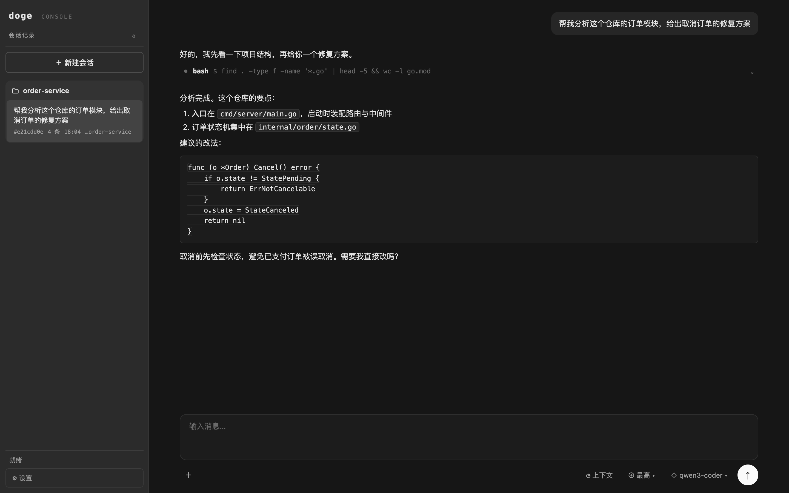
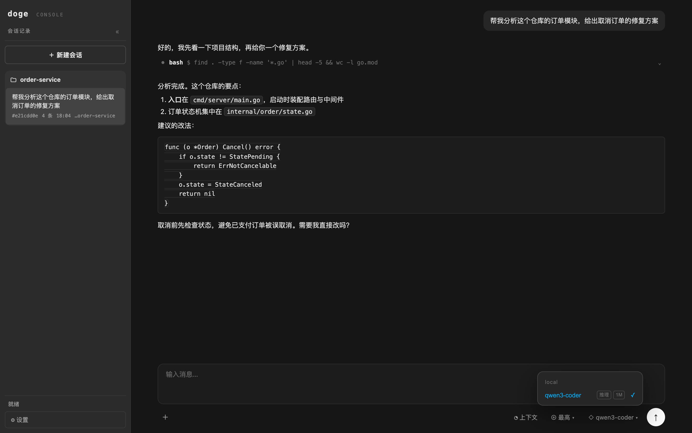
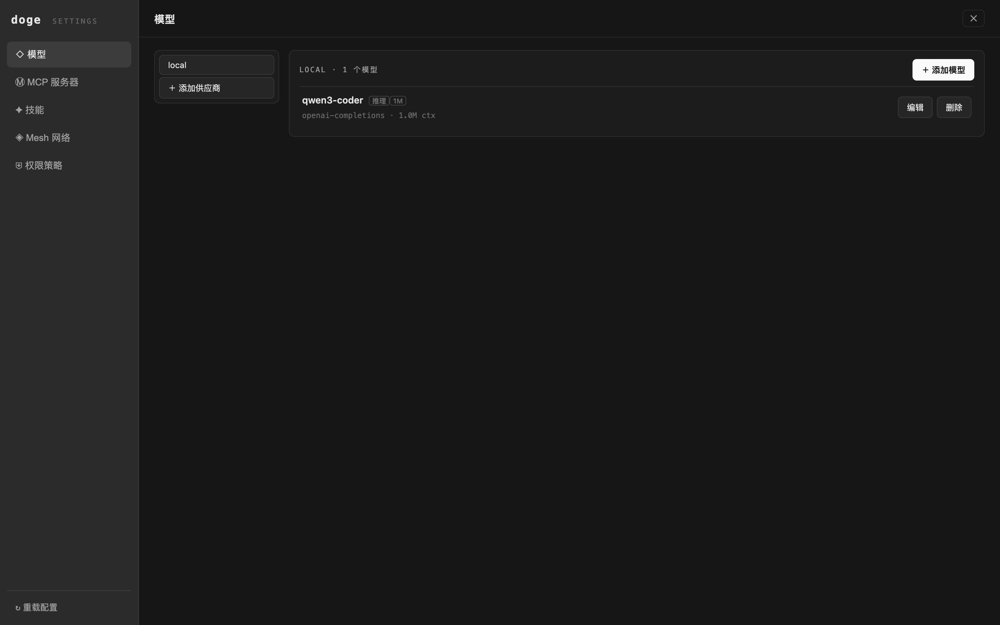
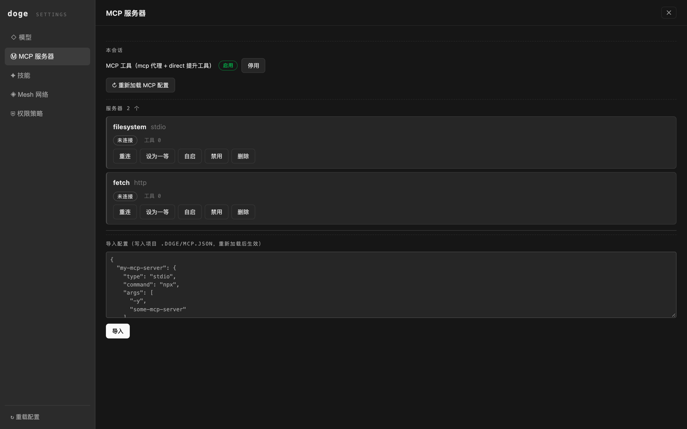
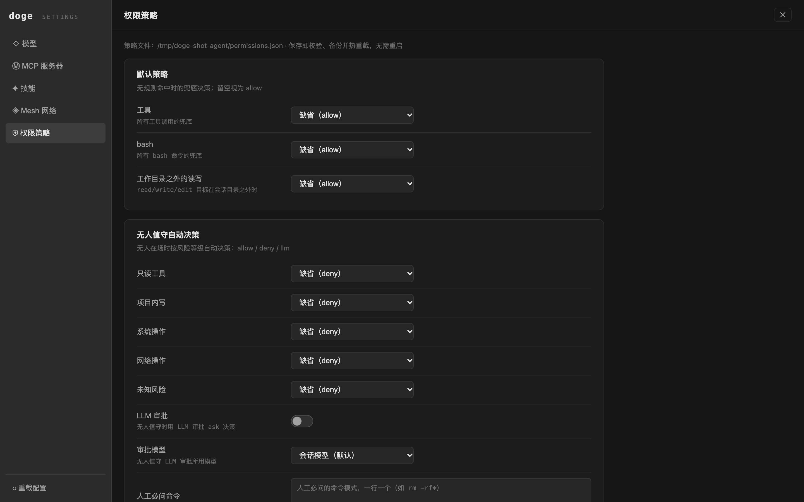
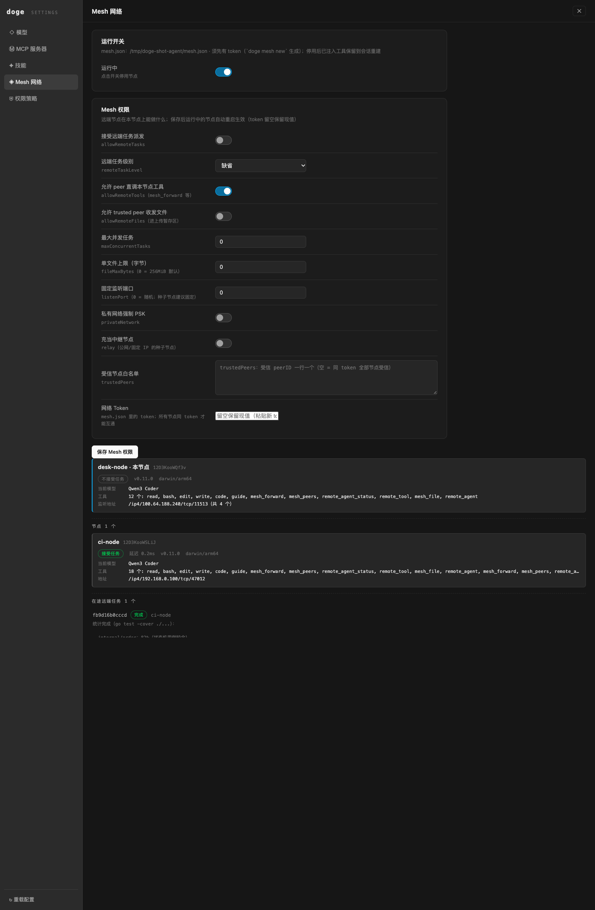
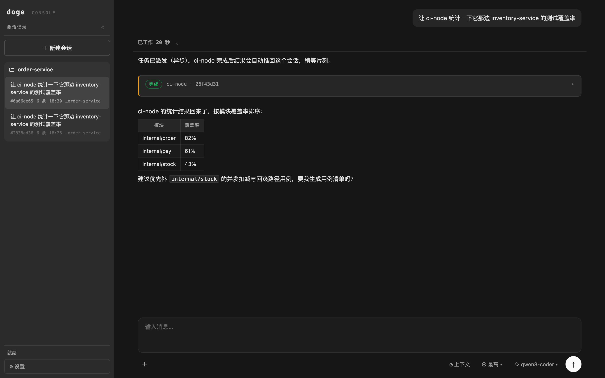
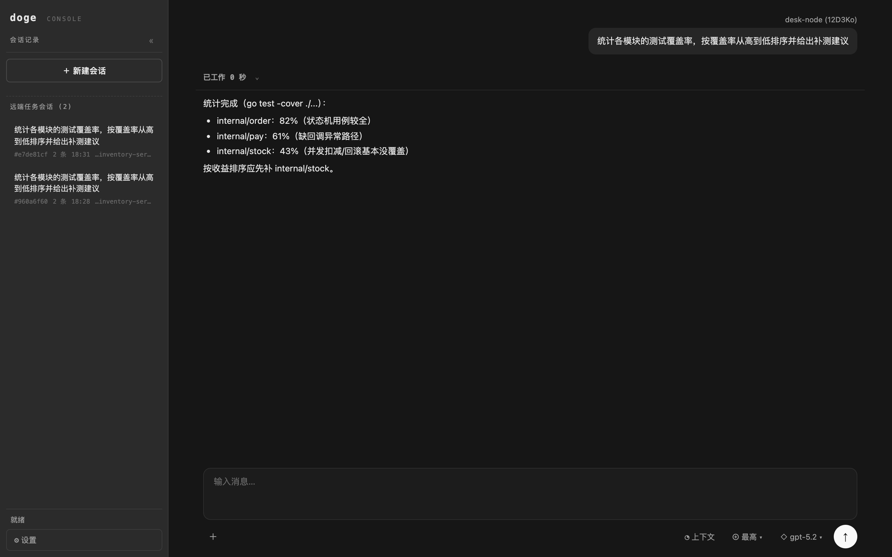

# doge

一个交互式编码 agent CLI。基于命令行的 agent 循环，支持多模型网关、工具调用、
权限控制、程序化工具调用（PTC）与全功能 TUI。

**Go 1.26+** · **macOS / Linux** · **单二进制，零运行时依赖** · **MIT License**

```
┌─────────────┬──────────────┬─────────────┐
│ TUI         │  Web 控制台   │  桌面客户端   │   ← 三种界面，同一 agent 内核
│ (bubbletea) │  (WebSocket) │  (wails v3) │
├─────────────┴──────────────┴─────────────┤
│ agent 循环：流式 turn · 工具编排 · 会话树    │
├────────┬─────────┬───────────┬────────────┤
│ 内置工具 │ PTC code │ Skills/MCP │ 权限层      │
├────────┴─────────┴───────────┴────────────┤
│ 多模型网关：OpenAI / Anthropic / 兼容服务    │
└───────────────────────────────────────────┘
        ＋ 可选：P2P mesh（-tags mesh，libp2p）
```

## 界面预览

Web 控制台与桌面客户端共用同一套界面（中性灰控制台设计）：

**主工作区**——会话侧栏、流式对话、工具调用卡片、composer：



**模型选择**——按 provider 分组，只列当前可用的模型（能解析到密钥或本地端点），徽标标注视觉/推理/上下文规格：



**设置中心**——模型 / MCP 服务器 / 技能 / Mesh / 权限策略五个面板：

| 模型管理（provider 分组 + 模型增删改） | MCP 服务器（导入/启停/一等提升） |
|:---:|:---:|
|  |  |

| 权限策略（默认决策/规则/无人值守分级） |
|:---:|
|  |

**Mesh 网络与远端任务派发**——Mesh 面板：运行开关、节点卡（能力/延迟/工具集）与在途任务；`remote_agent` 把任务派发到远端节点执行，完成后结果自动推回会话：



| 派发方：任务卡带节点名，结果以表格回推 | 执行方：任务气泡标注来源节点，归入「远端任务会话」 |
|:---:|:---:|
|  |  |

## 功能

- **Agent 循环**：流式 turn（文本/推理/工具调用）、steering 与 follow-up 消息双队列、并行/串行工具执行、中断、失败编码为流内事件
- **LLM Provider**：OpenAI Responses API、OpenAI Chat Completions（DeepSeek / Qwen / Moonshot / GLM / Z.ai / OpenRouter 等兼容服务）、Anthropic Messages API
- **内置工具**：read、write、edit（模糊匹配 + unified diff）、bash（超时、进程树清理）、grep、find、ls（gitignore 感知）
- **Programmatic Tool Calling（PTC）**：`code` 工具让模型写 JS/Python 脚本编排工具调用，脚本内过滤/聚合后再回传精简结论（详见下文）
- **会话**：append-only JSONL 会话树（`~/.doge/agent/sessions/…`）、分支、恢复、LLM 摘要压缩（compaction）；**惰性创建**——启动不产生任何磁盘痕迹（连会话目录都不建），首条消息（含用户消息）落盘时才创建目录与文件，运行中的会话因此可被其它窗口定位与接管；管道空调用（如 `echo -n "" | doge -p`）直接拒绝，不发起 LLM 请求
- **Skills 闭环（0.9.0）**：SKILL.md 技能发现（渐进式披露）、`skill` 工具加载、`/skill:name` 显式注入、`<skill …/>` 调用块回填，管理 API + Web 面板（详见下文「Skills 与模板」）
- **运行模式**：交互式（bubbletea TUI）、print、JSON 事件流、HTML 导出
- **Web 控制台**：token 授权访问（Bearer / cookie 双通道）、WebSocket 实时事件流，与 TUI 同进程共享会话（仅 TUI / 仅 Web / 两者同时）
- **桌面客户端（0.11.0）**：wails v3 原生窗口复用 Web 控制台前端（详见下文「桌面客户端」）
- **文件上传与附件**：📎/拖拽/粘贴上传进暂存区（`~/.doge/agent/uploads`，配额与保留期可配），附件随消息进对话——图片多模态直注、小文本全文注入、大文件引用行交 agent `read`；确定性 place / apply（mcp / models / skills-zip / permissions，双段确认）；mesh 跨节点文件传输（`mesh_file`，默认关，见下文）
- **Mesh（P2P）**：libp2p 自研轻量对等网络（`-tags mesh` 构建启用）——mDNS/DHT 发现、PSK 互验准入、AgentProfile 能力广播、声明式端口转发（expose/listen、unix socket 桥接、热启停）、`mesh_forward` agent 工具、远端任务派发（`remote_agent`）、远端节点级工具直接调用（`remote_tool`）、跨节点文件传输（`mesh_file`）、断网自动重连自愈、NAT 穿透（端口映射/自动中继/打洞）
- **MCP（Model Context Protocol）**：社区标准 `mcpServers` 配置接入任意 MCP server（stdio / Streamable HTTP），`mcp` 代理工具按需 search→describe→call 控制上下文，`directTools` 把高频工具提升为一等工具；懒加载 + 磁盘缓存 + 空闲回收（详见下文）

## 快速开始

```bash
# 先构建（产物在 dist/，默认构建不含 mesh）
make build && ./dist/doge --version

# OpenAI 兼容服务（DeepSeek / Qwen / Moonshot / GLM 等）
export DEEPSEEK_API_KEY=sk-...
doge --model deepseek/deepseek-chat

# Anthropic
export ANTHROPIC_API_KEY=sk-ant-...
doge --model anthropic/claude-sonnet-4-5

# 非交互模式（注意：-p 是 bool 开关，--model 等选项放在消息前面）
doge --model openai/gpt-5.2 -p "介绍一下这个仓库"
doge --mode json "…"

# 恢复最近会话
doge --continue

# 导出会话为 HTML
doge --export <session-id>

# Web 控制台（与 TUI 同时，二者共享同一会话）
doge --web

# 仅启动 Web 控制台（无 TUI，适合容器/远程）
doge --web --no-tui --port 8080 --web-host 0.0.0.0

# 桌面客户端（wails v3 原生窗口，界面即 Web 控制台）
make desktop && ./dist/doge-desktop
```

P2P Mesh（需要 `-tags mesh` 构建，见[开发](#开发)）：

```bash
doge mesh new --name mynode      # 生成网络 token（写入 ~/.doge/agent/mesh.json）
doge mesh daemon                 # 常驻节点（无 agent 会话，Ctrl+C 退出）
doge mesh peers --wait 5         # 列出已发现的节点及其能力
doge --mesh                      # 让 mesh 与 agent 会话共存（TUI/print/Web 均可）
```

## 配置

配置文件都在 `~/.doge/agent/`（可用 `DOGE_CODING_AGENT_DIR` 覆盖路径）。首次运行只创建目录结构，配置文件需要手工编辑；以下格式与代码实际读取/写入完全一致。完整版（目录结构、环境变量表、全部字段与示例）**内置于二进制**：直接问 doge 任何用法/配置问题（agent 经内嵌 `guide` 工具按模块查询），仓库内源文件见
[docs/usage.md](docs/usage.md)（指向说明）与 `internal/guide/guide.md`。

### AGENTS.md —— 全局指令与项目上下文

上下文文件分两层，注入系统提示词（`/reload` 热重读，不存在则跳过）：

- `~/.doge/agent/AGENTS.md`（**全局**）：跨项目的角色设定、环境定义、回复偏好——对应其它工具的全局 CLAUDE.md / soul.md
- `<项目>/AGENTS.md` 或 `CLAUDE.md`（**项目**，先到先得）：本仓库的工作约定

注入顺序为 内置操作规则 → `<user_instructions>`（全局）→ `<project_context>`（项目）→ 技能清单 → cwd/平台/日期；全局在前、项目在后，项目层可覆盖全局的细节约定。`--system-prompt` 则是整体替换内置提示词（连操作规则与工具清单一起去掉），只适合实验场景。

### auth.json —— API 密钥

按 provider 存密钥，每个 provider 一条：

```json
{
  "openai":    { "type": "api_key", "key": "sk-..." },
  "anthropic": { "type": "api_key", "key": "sk-ant-..." },
  "model":     { "type": "api_key", "key": "sk-..." }
}
```

- `provider` 必须与模型配置里的 `provider` 一致（内置 provider：`openai` / `anthropic` / `deepseek` / `qwen` / `moonshot` / `zhipu` / `zai` / `openrouter` / `local`；自定义模型用自己的 provider 名）
- 密钥解析优先级：`--api-key` 参数 > `auth.json` > 环境变量（`OPENAI_API_KEY`、`ANTHROPIC_API_KEY`、`DEEPSEEK_API_KEY` 等）

### models.json —— 自定义模型

JSON 数组，每个元素一个模型，字段与代码中的模型定义一一对应：

```json
[
  {
    "id": "deepseek-v4-flash",
    "name": "Deepseek-v4-flash",
    "api": "openai-completions",
    "provider": "model",
    "baseUrl": "https://api.example.com/v1",
    "contextWindow": 1000000,
    "maxTokens": 384000,
    "input": ["text"],
    "reasoning": true,
    "thinkingLevelMap": {
      "minimal": "low", "low": "low", "medium": "medium",
      "high": "high", "xhigh": "high", "max": "high"
    },
    "headers": {
      "X-Api-Version": "2026-08-01"
    },
    "sessionAffinity": "openrouter",
    "impersonate": "codex",
    "cost": {
      "input": 0, "output": 0, "cacheRead": 0, "cacheWrite": 0,
      "currency": "¥",
      "multiplier": 1,
      "peakValley": {
        "periods": [
          { "start": "23:00", "end": "07:00", "multiplier": 0.5 },
          { "start": "09:00", "end": "11:00", "multiplier": 1.5 },
          { "start": "19:00", "end": "21:00", "multiplier": 1.5 }
        ]
      }
    }
  }
]
```

- `api`：`openai-responses` / `openai-completions` / `anthropic-messages`
- `input`：`["text"]` 或 `["text", "image"]`
- `reasoning: true` 启用思维模式；`thinkingLevelMap` 把 doge 思维级别映射到模型参数——anthropic 系为 token 预算（数字），openai 系为级别字符串（如 `"high"`）；聚合站 DeepSeek 系下 assistant 历史会回传 `reasoning_content`
- `cost`：单价（每 M tokens，单位自定）+ 费用展示配置，全部可填 0/省略
  - `input`/`output`/`cacheRead`/`cacheWrite`：单价，填你实际计费的币种值即可
  - `currency`：统计里费用前缀的货币符号（如 `$` / `¥` / `€` / `CNY`），缺省 `$`
  - `multiplier`：单价 → 展示值的换算倍率。单价与 `currency` 同单位时保持 `1`（或省略）；若单价存的是美元而想按 `¥` 展示，填汇率（如 `7.2`）
  - `peakValley.periods`：峰谷价时段，`start`/`end` 为本地时间 `HH:MM`（`end` 早于 `start` 表示跨午夜，如 `23:00`–`07:00`；`00:00`–`24:00` 表示全天），`multiplier` 为该时段的费用倍率，可配置任意多个时段，时段左闭右开
- `headers`（可选）：随每次请求附加的 HTTP 头，键名大小写不敏感。值为 `null`（或 `""`）表示**抑制**该头——连请求层的默认头（`User-Agent` / `Accept` / `Content-Type` / 鉴权头等）一起删除，例如 `"User-Agent": null` 即可不发送 UA。同名头请求级设置优先于模型级
- `sessionAffinity`（可选）：缓存亲和头开关。有会话 ID 时启用：`"openai"` 发 `session_id` + `x-client-request-id` + `x-session-affinity`，`"openrouter"` 发 `x-session-id`，其他非空值发 `x-client-request-id` + `x-session-affinity`；缺省关闭（对应 Pi 的 `compat.sendSessionAffinityHeaders`）。仅对支持提示词缓存亲和的网关（OpenAI / OpenRouter 系）有意义
- `impersonate`（可选）：**客户端身份声明**。部分聚合网关按客户端工具（claude-code / codex 等）限制模型或差异化计费，这些网关只认请求头里的客户端标识；设了该字段后 doge 发请求时带上对应客户端的 `User-Agent` 与署名头，让流量被网关按该客户端的规则对待——不设则 doge 以自己的 UA（`doge/<version>`）直连。适用于你有权在该网关下以对应客户端身份消费的场景；请遵守网关的服务条款（值均经对应仓库源码核实）：

  | 值 | 注入的 User-Agent | 附加署名头 |
  |---|---|---|
  | `claude-code` | `claude-cli/2.1.75 (external, cli)` | `x-app: cli` |
  | `codex` | `codex_cli_rs/0.0.1` | `originator: codex_cli_rs` |
  | `openclaw` | `openclaw/2026.7.1` | `HTTP-Referer: https://openclaw.ai`、`X-OpenRouter-Title: OpenClaw`、`X-OpenRouter-Categories: cli-agent,cloud-agent,programming-app,…` |

  版本号是代表性值，会随上游发布漂移；若网关要求具体版本，用 `headers` 里的 `User-Agent` 显式覆盖（显式 headers 优先级最高）。值大小写不敏感，未知值忽略。**没有 `cursor` / `opencode`**：opencode 的 LLM 传输层不设 User-Agent（无一致可复现的标识）；cursor 闭源、UA 无公开可核实值。`codex` 的 `originator` 后端有白名单（值不对 403），`ChatGPT-Account-ID` 等仅在其原生端点校验，通用 OpenAI 兼容网关上主要是 `User-Agent` 被识别。**责任边界**：是否允许以特定客户端身份接入由网关方判定，使用前请自行确认所在网关的条款；该功能仅改写请求头，不绕过任何鉴权

内置模型目录：`doge --list-models`

### settings.json —— 设置（全局 + 项目合并）

全局文件 `~/.doge/agent/settings.json`；项目级文件 `<项目>/.doge/settings.json`。两者读取后深合并，**项目配置优先**。当前生效字段：

```json
{
  "defaultProvider": "model",
  "defaultModel": "deepseek-v4-flash",
  "defaultThinkingLevel": "max",
  "streamIdleSeconds": 120,
  "compaction": { "enabled": true, "reserveTokens": 40000, "keepRecentTokens": 120000 },
  "uploads": { "maxRequestBytes": 104857600, "maxFileBytes": 104857600, "quotaBytes": 536870912, "retentionDays": 7, "maxImageInlineBytes": 5242880, "maxTextInlineBytes": 65536 }
}
```

- `defaultProvider` + `defaultModel`：同时设置时作为默认模型（未传 `--model` 时生效）
- `defaultThinkingLevel`：未显式指定思维级别时的默认值
- `streamIdleSeconds`：提供商静默预算（秒，默认 120）——SSE 连接超过该时长无任何数据（或请求迟迟等不到响应头）即判定提供商停摆，自动中断本次流并释放会话，避免 agent 运行永久挂起、Web UI 假死
- `compaction`：上下文压缩开关与阈值（`Enabled` / `ReserveTokens` / `KeepRecentTokens` 是代码中的结构体字段名，JSON 匹配大小写不敏感，小驼峰写法同样生效）
- `uploads`：上传暂存区限制（零值全取默认，上例即默认值）——单请求/单文件 100 MiB、暂存区总配额 512 MiB（超额按最旧先删）、保留 7 天（每小时后台清理）、图片直接注入对话上限 5 MiB、文本全文注入上限 64 KiB

### mcp.json —— MCP 服务器（全局 + 项目合并）

社区标准 `mcpServers` 格式，三个文件按优先级合并（后者优先，字段级合并）：

1. `~/.doge/agent/mcp.json`（全局）
2. `<项目>/.doge/mcp.json`（项目）
3. `<项目>/.mcp.json`（项目共享，与其它工具互通）

```json
{
  "mcpServers": {
    "chrome": {
      "type": "stdio",
      "command": "npx",
      "args": ["-y", "chrome-devtools-mcp@latest"],
      "directTools": ["get_screenshot", "navigate"]
    },
    "docs": { "type": "http", "url": "https://mcp.example.com/mcp" }
  },
  "settings": {
    "toolPrefix": "__",
    "idleTimeout": 600,
    "requestTimeoutMs": 30000,
    "approveTools": ["chrome__*"]
  }
}
```

- `type`：`"stdio"`（command+args，缺省）或 `"http"`（+url；`"sse"` 视同 http）——与
  Claude Desktop / Cursor 等工具的 `mcpServers` 粘贴格式互通，Web 控制台的 MCP
  面板可直接整段导入

- server 级字段：`type`（`"stdio"`/`"http"`）、`command`/`args`（stdio）、
  `url`（Streamable HTTP）、`env`、`headers`、`disabled`、
  `autoStart`（发现/重载后自动启动并连接；默认懒连接）、
  `directTools`（`true`=全部提升为一等工具，或工具名数组）、
  `includeTools`/`excludeTools`、
  `approveTools`（glob；配置后未命中的工具调用直接拒绝）、`searchKeywords`
- 顶层 `settings`：`toolPrefix`（direct 工具名前缀，默认 `__`，命名 `server__tool`）、
  `idleTimeout`（空闲回收秒数，默认 600）、`requestTimeoutMs`（默认 30000）、
  `directTools`、`approveTools`、`trace`
- **懒加载**：没有 mcp 配置就不初始化、不建缓存目录、不 spawn 任何进程
- 工具元数据缓存到 `~/.doge/agent/mcp-cache/<server>.json`，`mcp search/describe`
  无连接也能用；`/mcp reconnect` 或首次调用时拉取刷新

## TUI

- **主题**：消息背景块、工具状态色块（执行中/成功/错误）、思考斜体、两行 footer（工作目录 + token 统计 / 模型 • 思维级别）
- **思考与工具结果折叠**：默认折叠，点击对应行展开/再点击收缩；`ctrl+t` 全局切换思考、`ctrl+o` 全局切换工具输出
- **快捷键**：`↑/↓` 输入历史（从会话加载）、`esc` 中断、`ctrl+c` 清空输入（空输入时退出）、`ctrl+d` 退出、`ctrl+y` 复制最后回复到剪贴板（OSC 52）、鼠标滚轮滚动、`/` 命令菜单
- **配置重载**：`/reload` 手动重新读取 `models.json` / `auth.json` / `permission.json`，热刷新技能目录并重读全局/项目 `AGENTS.md` 上下文（均无需重启）。改完模型单价/货币/峰谷价、权限规则、技能或 AGENTS.md 后执行即可，再 `Esc` 关闭 `/stats` 重新查看生效后的费用
- **权限确认条**：ask 决策时状态行显示 `⚠ 权限请求`，`y` 放行一次、`a` 本次会话放行、`d`/`esc` 拒绝

## Web 控制台

`doge --web` 启动带 token 授权的 Web 控制台。Web 与 TUI **同一进程**运行：共享同一个 `AgentSession`（实时互相可见），事件通过 `AgentListener` 广插到 WebSocket 客户端，会话仍写入同一个 JSONL 文件。状态栏的「重载」按钮等价于 TUI 的 `/reload`（`POST /api/reload`），手动重新读取 `models.json` / `auth.json` / `permission.json`，热刷新技能并重读 AGENTS.md 上下文。三种启动方式：

```bash
doge                    # 仅 TUI（默认，未启用 Web）
doge --web              # Web + TUI 同时运行
doge --no-tui           # 仅 Web（headless；隐含 --web，日志同时打印到控制台，适合 Docker/远程）
doge --web --no-tui --port 8080 --web-host 0.0.0.0
```

### 授权与安全

- 默认绑定 `127.0.0.1`；`--web-host 0.0.0.0` 可暴露到局域网（此时 token 是唯一防线，注意保管）
- 每次启动自动生成 32 字节随机 token（`crypto/rand`），打印在控制台并写入 `~/.doge/agent/web-token`（0600，重启即失效）
- `--web-token <token>` 固定 token（适合团队/共享部署）；`?token=` 可自动登录
- 凭证三通道：`Authorization: Bearer <token>`（客户端/独立部署 WebUI 推荐）、`?token=`（浏览器 WS）、登录换发的 HttpOnly + SameSite=Strict 会话 cookie（7 天，内置前端路径）。所有 `/api/*` 与 `/ws` 均需鉴权
- 跨域（CORS）默认关闭；`--web-cors <origin>`（可重复，或 `'*'`）允许剥离部署的 WebUI 从浏览器跨域调用，settings `web.corsOrigins` 同义
- 权限弹窗：纯 Web 模式下由浏览器确认放行/拒绝；Web+TUI 并存时权限询问交给 TUI 处理

除浏览器前端外，HTTP API 面向客户端场景提供完整的 agent 管理能力（会话/模型/配置/
skills/mesh/日志/关停），规范见 `docs/web-api.md`。

### 参数

| 参数 | 说明 | 默认 |
|---|---|---|
| `--web` | 启用 Web 控制台 | 关 |
| `--no-web` | 禁用配置里启用的 Web 控制台 | 关 |
| `--port <n>` | 端口 | `settings.web.port`，否则 `8080` |
| `--web-host <host>` | 监听地址 | `settings.web.host`，否则 `127.0.0.1` |
| `--no-tui` | 仅 Web（隐含启动 Web 控制台；日志同时打印到控制台） | `settings.web.noTui`，否则关 |
| `--web-token <tok>` | 固定访问 token | `settings.web.token`，否则每次随机 |
| `--web-cors <origin>` | 允许跨域调用的来源（可重复，或 `'*'`） | `settings.web.corsOrigins`，否则不开 |

优先级：**CLI 参数 > settings.json 的 `web` 节 > 内置默认**。CLI 参数不传时从配置文件取值。

配置文件（`~/.doge/agent/settings.json`，项目级 `.doge/settings.json` 可覆盖全局）：

```json
{
  "defaultProvider": "model",
  "defaultModel": "deepseek-v4-flash",
  "web": {
    "enabled": true,        // 配置即启动 Web，无需 --web
    "host": "0.0.0.0",      // 监听地址（对外暴露时 token 是唯一防线）
    "port": 8080,
    "token": "my-secret",   // 固定 token；缺省则每次随机生成
    "noTui": true,          // 仅 Web（headless）
    "corsOrigins": ["https://ui.example.com"]  // 允许跨域的 WebUI 来源
  }
}
```

环境变量 `DOGE_WEB_NO_OPEN=1` 可禁止自动打开浏览器（用于 CI/无头环境）。

### 会话管理

- **TUI**：
  - `/new` 立即开始一个全新会话（无需重启进程），历史留在 `~/.doge/agent/sessions/…`
  - `/` 唤起命令菜单后边输边过滤，**Tab 补全**高亮命令（参数命令补全后留空格待输入，普通命令补全后再按 Enter 执行）
  - `/sessions` 打开同目录历史会话选择器：↑/↓ 选择、**Enter 打开**、**d 按两次删除**（高亮项标记 `[再按 d 确认删除]`，↑/↓ 或 Esc 取消）、Esc 关闭，条目含首句预览；或 `/open <id>` 直接按 id 切换
  - `/stats` 显示本会话 token 统计覆盖层（Esc 关闭）：消息数、输入/输出/推理 token、缓存命中与命中率、合计、估算花费
  - `/compact` 手动触发上下文压缩（LLM 摘要重写历史）
  - TUI 的会话切换/删除仅限**当前工作目录**内的历史会话，当前会话不可删除
- **Web（左右布局）**：左侧为可折叠的会话列表（状态栏 ☰ 或侧栏 « 收起/展开），每项显示**会话首句预览**（截断）、消息数、时间与目录；右侧为消息聊天区
  - 任意历史**用户消息**悬停显示 ✎：内联编辑后「保存并重新执行」——回滚到该轮、替换文本并重跑（会话按分支重写，旧尾部自动弃用）；输入框 ↑/↓ 可回填最近发送的消息再编辑重发
  - 「＋ 新建会话」随时开新会话；点击任意条目切换（跨目录可切）
  - 悬停条目显示 ✕ 删除按钮（带确认）；**当前会话**与 **TUI 正在使用的会话**受保护不可删除
- **共享与分叉**：Web 启动时与 TUI 共享同一会话（实时互相可见）；Web 第一次「新建/切换会话」时自动**分叉**出自己独立的 Agent 会话（独立转录、独立工作目录绑定），此后两端各跑各的、互不影响——TUI 的会话与所在目录保持不变（不切换进程目录），Web 侧工具通过按会话绑定的工作目录在新目录执行
- 目标会话的目录已不存在时会拒绝切换并给出原因

### 前端与 API

- 轻量 SPA（原生 HTML/CSS/JS，零构建，`go:embed` 打进单二进制），深色主题；支持 markdown 渲染、thinking/工具块折叠、模型切换、上下文压缩、实时流式输出（rAF 节流）、「✦ Skills」技能面板（安装技能一览与本会话加载的技能）
- 模型下拉框只列出**可用的模型**：能解析到 API key（`auth.json` 或环境变量）的，或本地端点（无需 key）——不会出现目录里有但实际没有凭据的模型；当前活动模型始终保留在下拉框中
- WebSocket `/ws`：连接即下推 `session_info` 全量快照，随后按 `agent_start → turn_start → message_start/update/end → tool_execution_* → turn_end → agent_end` 推送实时事件
- REST：`/api/status`、`/api/stats`（会话 token/缓存/花费统计）、`/api/prompt`（v5 起支持 `attachments` 附件引用）、`/api/abort`、`/api/compact`、`/api/reload`（重读 models/auth/permission 配置）、`/api/turn/edit`（回滚重写某轮用户消息）、`/api/models`、`/api/model`、`/api/session`、`/api/sessions`（含首句预览 `firstMessage`）、`/api/session/new`、`/api/session/switch`、`/api/session/delete`、`/api/session/mcp`、`/api/session/skills`、`/api/skills`、`/api/skills/{name}`、`/api/uploads`（上传/列表/下载/删除/place/apply，见下节）、`/api/auth/login|logout`、`/api/config`、`/api/config/settings`、`/api/config/auth`、`/api/logs`、`/api/permission/answer`、`/api/mesh`、`/api/mesh/forwards`、`/api/mcp`、`/api/shutdown`（完整规范见 `docs/web-api.md`）

### 文件上传与附件

上传与发送**两步分离**：文件先 `POST /api/uploads`（multipart，可多文件）进暂存区 `~/.doge/agent/uploads/<id>/`（内容 + meta.json，含 sha256 与来源），拿到 uploadID 后随 `POST /api/prompt` 的 `attachments` 字段进对话——重发消息不必重传文件，会话 JSONL 只存引用。附件进入对话的规则：

| 附件 | 处理 |
|---|---|
| 图片（内容嗅探 image/*）且模型支持图片输入且 ≤5 MiB | 直接作为 image 内容块进入用户消息（多模态） |
| 文本类且 ≤64 KiB | 全文注入 text 块 |
| 其余（大二进制/超限图片/模型不支持图片） | 引用行（绝对路径 + size/mime/sha256），agent 按需 `read`/`bash` 处理 |

前端输入框支持 📎 选择、拖拽、粘贴截图；转录里图片直显（`/api/uploads/{id}/content`）、其他显示为可下载文件卡片。

除交给 agent 的主路径外，还有两条**确定性路径**（不经 LLM、不经 permissions，守卫是 web token + 白名单）：

- `POST /api/uploads/{id}/place`：把文件复制到白名单目的地——会话 cwd 子树、`~/.doge/agent/skills/` 子树、`models.json`/`mcp.json` 两个精确文件（EvalSymlinks 后复核，symlink 拒绝）
- `POST /api/uploads/{id}/apply`：应用为配置，双段确认（默认 dry-run 出 diff 预览，`confirm:true` 才落盘 + 触发 reload）。`kind`：`mcp`（合并进项目 `.doge/mcp.json` 并分发新工具）、`models`（备份 `.bak` 后整体替换）、`skills-zip`（zip-slip/symlink 安全解包安装，技能热刷新即时生效）、`permissions`（备份后整体替换）。`auth.json`/`mesh.json`/`settings.json` 不提供 apply

## 桌面客户端

`make desktop` 构建原生桌面客户端（`dist/doge-desktop`，wails v3 + WKWebView）。桌面端是**独立于 Web 控制台的 wails 原生应用**：前端自有（`desktop/frontend/`，视觉沿用中性灰控制台设计）、数据面走 typed Service 绑定 + wails Events 事件桥，**不监听任何端口、无 token、无登录**，与 Web 控制台（`internal/web` + webui）互不影响。

- **Service 层**（`desktop/services/`）：会话/对话、模型、配置、MCP、技能、Mesh、上传按域拆分，前端 `Call.ByName` 直调；响应结构与 `docs/web-api.md` 一致，错误按类别（busy/notfound/unavailable…）分支
- **事件桥**：agent 事件序列化为 `console` 帧（结构 1:1 对齐 Web 控制台的 WS 事件流）经 wails Events 推送；权限询问走「发帧 + 等待应答」，5 分钟超时
- **原生集成**：菜单栏（⌘N 新建会话、⌘. 中断、⌘, 偏好设置、⌘R 重载配置）、**系统托盘**（关窗驻留，点击/菜单唤回，⌘Q 才彻底退出）、新建会话用**原生目录选择对话框**
- 初始工作目录取最近一个会话的 cwd（目录已删除则回退 `$HOME`），与 CLI 共享 `~/.doge/agent/` 全套配置与数据
- CLI 参数：`--mesh` / `--mesh-token`（需 `-tags mesh` 构建，即 `make desktop-mesh`）、`--version`
- 打包 macOS .app：`make desktop-app`（需要 wails3 CLI：`go install github.com/wailsapp/wails/v3/cmd/wails3@latest`）
- 平台要求：macOS 11+（arm64/amd64），构建需 CGO（Xcode Command Line Tools）；窗口层用 [wails v3](https://v3.wails.io/)（`desktop/` 独立 module，CLI 构建不引入 wails 依赖）

## Skills 与模板

技能与 prompt 模板都是**纯文件配置**（技能为 SKILL.md，agentskills.io 格式），增删无需重启；发现目录为 `~/.doge/agent/skills` 与 `<项目>/.doge/skills`（模板同理在 `prompts/`，`--skill` / `--prompts` 可整体替换默认目录）。

模型侧通过三条路径使用技能（渐进式披露，设计见 `docs/skills-design.md`）：

- **发现**：system prompt 只列已安装技能的 name + description（`<available_skills>` 块），不塞正文
- **加载**：`skill` 工具按名读取 SKILL.md 全文后照着执行（模型主动路径，非交互模式可用）
- **显式注入**：用户输入 `/skill:name` 直接注入正文；模型/用户消息里的 `<skill name location/>` 调用块也会被 harness 识别并回填

Web 控制台状态栏「✦ Skills」面板展示安装技能（含发现目录、description、SKILL.md 路径）与本会话加载的技能；API：`GET /api/skills`、`GET /api/skills/{name}`、`GET /api/session/skills`（见 `docs/web-api.md` §4.12）。

## MCP（Model Context Protocol）

接入任意社区标准 MCP server（stdio 子进程 / Streamable HTTP），**默认构建内置**。
设计要点与完整文档见 `docs/mcp-design.md`。

### 使用

```bash
# 配置在 ~/.doge/agent/mcp.json 或项目 .mcp.json 里写好 mcpServers 后：
doge --web                  # 启动即可用（懒加载：无配置=零开销）
doge --no-mcp               # 显式禁用 MCP
doge --mcp-config /path/mcp.json   # 覆盖全局配置文件
doge --mcp-trace            # 请求级调试日志（写入 ~/.doge/agent/logs/doge.log）
```

模型侧通过一个 `mcp` 代理工具按需 **search → describe → call**（不把几百个 MCP
工具 schema 塞进 system prompt）；`directTools: ["tool_a"]` 或 `true` 可把高频
工具提升为一等工具 `server__tool`。

### TUI 命令

| 命令 | 说明 |
|---|---|
| `/mcp`、`/mcp status` | 面板：server 连接状态、工具数、缓存/错误（含已禁用项） |
| `/mcp tools [server]` | 列出工具（可过滤 server） |
| `/mcp reconnect [server]` | 立即重连（空=全部），刷新工具缓存 |
| `/mcp enable\|disable <server>` | 启用/禁用（写项目 `.doge/mcp.json`，不改源文件） |
| `/mcp setup` | 生成项目 `.mcp.json` 脚手架并重新发现 |

### Web 控制台管理入口

状态栏「Ⓜ MCP」打开管理面板：

- **本会话**：单独启用/停用本会话的 MCP 工具组（远端派发任务的会话不可单独
  配置）；改动标记「待重载生效」，点「应用（重载）」或顶栏「↻ 重载」落地——
  生效时机由用户手动决定
- **服务器列表**：连接状态、工具清单（点击展开）、一等/自启徽标，单服务器
  重连 / 一等提升切换（设为一等/改回代理）/ 自启切换 / 禁用 / 启用 / 删除
- **导入配置**：按社区 `mcpServers` JSON 格式整段粘贴导入（支持多项、同名字段
  合并），写入项目 `.doge/mcp.json`
- **重新加载 MCP 配置**：重读全部配置文件并重建连接（所有配置改动的生效入口）

对应 API：`GET /api/mcp`、`POST /api/mcp/reconnect|enable|disable|reload|servers`、
`DELETE /api/mcp/servers/{name}`、`GET/POST /api/session/mcp`（详见
`docs/web-api.md` §4.10–4.11）。

### API

`GET /api/mcp`（server 状态 + 工具列表）、`POST /api/mcp/reconnect|enable|disable`
`{server}`、`GET /api/config` 的 `mcp` 段（详见 `docs/web-api.md` §4.10）。

## Mesh（P2P 对等网络）

doge 内置一个自研的轻量 P2P 层（libp2p + kad-dht + mDNS），让多台机器上的 doge 组成**对等 mesh**：互相发现、PSK 互验、广播各自的能力（AgentProfile）、点对点收发消息，以及——最直接的用途——**端口转发**：把远端机器的服务（含 unix socket，如 docker.sock）安全地拉到本地端口。

Mesh 通过 `-tags mesh` 编译开关独立打包：**默认构建不含 libp2p**（二进制体积不变），需要 mesh 时用 `make build-mesh`。

### 概念

| 概念 | 说明 |
|---|---|
| token | 网络凭据（base64 JSON：`rendezvous` + `psk`，可内嵌 `bootstrapPeers`）。同一 token 的节点属于同一网络；token 经 `doge mesh new` 生成，线下共享 |
| 节点 | 每个 `doge mesh daemon` / `doge --mesh` 是一个节点，有唯一的 PeerID |
| 身份持久化 | 每个节点有自己的 `mesh-key`（`~/.doge/agent/mesh-key`，0600，**不要随 mesh.json 复制到别的机器**）——PeerID 跨重启稳定；`mesh.json` 的 `listenPort` 让节点监听固定端口。两者配合使 token 里嵌入的种子地址在服务器重启后依然有效 |
| 发现 | mDNS（局域网，秒级）+ DHT rendezvous（公网）+ 自建种子 bootstrap（公共 DHT 不可达时） |
| 准入 | 公网模式：连接建立后双方 `HMAC-SHA256(psk, 对端ID)` 互验，未持 token 的节点过不了互验、直接断连；`privateNetwork: true` 可切私有/VPN 模式（libp2p 传输层 PSK，网络内所有节点须同模式） |
| AgentProfile | 每个节点广播的能力声明（name/roles/skills/tools/model/cwds/accepting），`mesh peers` 即查看它 |

### 快速上手（单机即可验证）

```bash
# 1. 构建 mesh 二进制（默认 make build 不带 mesh）
make build-mesh          # 产物在 ./dist/doge-mesh

# 2. 创建网络并启动常驻节点（终端 1）
./dist/doge-mesh mesh new --name mynode
./dist/doge-mesh mesh daemon      # 打印节点 ID 与监听地址，Ctrl+C 退出

# 3. 另开终端，列出已发现节点（mesh peers 会起一个临时节点去探测）
./dist/doge-mesh mesh peers --wait 5
```

`mesh peers` 会显示每个节点的 ID、名称、版本、OS/Arch、角色、技能、延迟与地址。用**不同 token** 的节点探测只会得到 "No peers found"（互验被拒）。

### 端口转发

端口转发是声明式配置：一条端到端转发由两端各配一条规则组成——提供方 `expose`（发布本地服务）+ 访问方 `listen`（把本地端口桥接到远端服务）。规则写在 `mesh.json` 的 `forwards` 里；**运行中的节点每 3 秒自动热重载**，`doge mesh forward ...` 改完配置无需重启即生效；`enable/disable` 可热启停单条规则。

```bash
# A 端：发布本地服务
doge mesh forward add echo --mode expose --local 127.0.0.1:8080
doge mesh forward add docker --mode expose --local unix:///var/run/docker.sock   # unix socket

# B 端：把 A 的服务拉到本地端口
doge mesh forward add remote-echo --mode listen --bind 127.0.0.1 --port 8090 \
    --peer <A 的 PeerID> --remote echo
doge mesh forward add remote-docker --mode listen --bind 127.0.0.1 --port 2375 \
    --peer <A 的 PeerID> --remote docker

# 查看 / 热启停 / 移除
doge mesh forward list
doge mesh forward disable remote-echo   # 停用单条（关监听），其余不受影响
doge mesh forward enable  remote-echo   # 重新启用
doge mesh forward remove  remote-echo
```

效果：连 B 的 `127.0.0.1:8090` === A 的 `127.0.0.1:8080`；`docker -H 127.0.0.1:2375` 即操作 A 的 docker 守护进程。

**agent 可控**：mesh 会话（`doge --mesh`）里 agent 还多一个 `mesh_forward` 工具（`action=list|add|remove|enable|disable`，参数同 CLI），可以在任务执行中自行增删/启停转发，无需切终端。

**远端直接调用（`remote_tool`）**：本机 agent 还可以用 `remote_tool(peer, tool, args)` **直接调用对端节点的节点级工具**（`mesh_forward` / `mesh_peers` / `remote_agent_status`）——一次点对点消息往返即返回，不经远端 agent 派任务、远端不跑 LLM。典型用法：精确操作远端节点做 forward/listen 绑定（如"在 B 上 expose 它本地的 8090"→ `remote_tool(peer=B, tool=mesh_forward, args={action:add, mode:expose, ...})`），远端视角看网格、查远端在途任务同理。直接调用**默认开放**（`allowRemoteTools` 缺省即开——token 即准入边界；显式写 `false` 可关，`trustedPeers` 可收窄到指定节点），profile 带 `remoteTools` 标记（`mesh_peers` 可见）；会话级工具（read/bash 等）不走此通道，远端干"要多步思考的活"仍用 `remote_agent`。`mesh daemon` 无会话节点同样可接受直接调用。

**peer 别名**：`remote_agent` / `remote_tool` / `mesh_forward` 的 `peer` 参数都可以用**节点名**（mesh.json 的 `name`，`mesh_peers` 输出里的 `name=`）代替完整 peer ID；名字在已连节点中必须唯一——重名会立即报错并列出候选 peer ID，未知名报"节点不存在"，两种情况 agent 都会被引导改用精确 peer ID。`mesh_forward` 的 listen 规则落盘时会把名字解析成真实 peer ID。

**跨节点文件传输（`mesh_file`，默认关）**：mesh 会话里 agent 可用 `mesh_file` 在节点间搬运文件——`stage`（本地文件入暂存区）、`send`（推到对端暂存区）、`pull`（从对端拉回，如远端任务产物）、`list`（查对端暂存区里自己发去的文件）。`remote_agent` 也接受可选 `files` 参数：派发前自动把文件送到对端暂存区，任务文本前注入引用行，远端 agent 照常 `read`。文件走独立 `/doge/file/0.1` stream（JSON 头 + 裸字节流），sha256 全程校验；**对端只收进暂存区，绝不直达文件系统**。开关 `allowRemoteFiles` **默认关**（与 `allowRemoteTasks` 同构，`trustedPeers` 可收窄），`fileMaxBytes` 限单文件（默认 256 MiB）；pull 有归属校验——mesh 来的文件只回发给原发送方，web 上传的文件不对 mesh 暴露。

> ⚠️ 安全警告：`expose unix:///var/run/docker.sock` 等价于把本机 root 级控制权交给 mesh 内所有持 token 节点。仅在与完全可信的节点组网时使用。

### 双机 / 公网组网

- **同一局域网**：两台机器共享同一 token（A 用 `mesh new` 建网，B 用 `doge mesh join <token>` 加入），各自 `doge mesh daemon`，mDNS 秒级互发现。
- **同一台机器起多个节点（测试）**：⚠️ mDNS 在本机跨进程组播不可靠（macOS 上约 2/3 成功率，是 zeroconf 共享组播 socket 的固有限制）。可靠做法是让后起的节点**直连先起的节点**：把先起节点的监听地址（`/ip4/127.0.0.1/tcp/<port>/p2p/<id>`，`mesh daemon` 启动时会打印）用 `doge mesh join <token> --bootstrap <addr>` 嵌入，连接确定性建立（实测 100%）。
- **跨公网（种子组网，重启稳）**：
  1. 种子节点监听**固定端口**：`doge mesh new --port 4001 --name seed`，在 mesh.json 里加 `"relay": true`，然后 `doge mesh daemon`（身份持久化在 `mesh-key`，重启后 PeerID 与端口都不变）。
  2. 客户端用 `doge mesh join <token> --bootstrap /ip4/<种子公网IP>/tcp/4001/p2p/<种子ID>` 加入——种子地址写进 token，任何新节点仅凭 token 就能连上它（经它加入私有 DHT，不依赖公共基础设施）。
  3. **种子重启后，token 里嵌入的地址依然有效**（PeerID + 端口均稳定），客户端断线后自动重连。

### NAT 穿透

- **路由器端口映射**：节点启动即尝试 UPnP/NAT-PMP 把监听端口映射到网关（失败自动忽略），映射成功后对端经 identify 学到公网地址可直接拨入。
- **自动中继**：节点把 `bootstrapPeers` 里的种子当作中继候选，自动在开启 `relay: true` 的种子上预约中继槽位并通告 `/p2p-circuit` 地址——两侧都在 NAT 后时经种子中继互通；VPN 内网种子（Tailscale/overlay IP）同样可用。
- **打洞升级**：经中继的连接会用 DCUtR 尝试协调两侧同时拨号升级为直连（TCP 直打洞成功率有限，失败则保持中继通路）。
- **中继准入**：中继只对 mesh 内节点开放（连接准入 + PSK 握手把关，错 token 节点握手即断、其预留随之失效），且不限制中继电路的时长/流量（端口转发是长连接）。

> 中继走种子转发的连接带宽受种子机器限制；能直连时 libp2p 优先直连，中继只是兜底路径。
- **`--mesh` 与 agent 共存**：`doge --mesh`（或 `--mesh --mesh-token <token>` 用指定 token 加入）让 mesh 与 TUI/print/Web 会话同进程运行，session 里即可用 `mesh_forward` 工具。

### 连接自愈

- **节点连接**：已认证过的 peer 断开后会被保留，后台每 10 秒对未连接的 peer 自动重拨（重连后自动重走互验 + 能力广播），网络闪断无需人工干预即可恢复；DHT 发现的 peer 另有每 60 秒的 findLoop 兜底。重拨时**携带历史连接地址**——被动连入的 peer 在 peerstore 里的地址只有 2~15 分钟 TTL，断网超过这个时长后仅按 ID 重拨会因"无地址"失败，携带地址可跨任意时长的断网恢复。种子连接为**持续保活**（断开后每 10 秒重拨，种子重启换端口也能恢复）。
- **中继兜底**：两侧都在 NAT 后直连不通时，经开了 `relay: true` 的种子中继互通（见「NAT 穿透」）；中继连接上还会尝试 DCUtR 打洞升级直连。
- **转发的长连接**：一条已建立的转发连接断开后**不会**自动重建（mesh 层不替客户端悄悄续连，这也是端口转发的常规语义，`ssh -L` 同理，客户端重连即可）；但**新建立的**转发连接是自愈的——只要对端节点恢复可达，`NewStream` 会按需重拨，新连接即通。

### mesh.json 配置

`~/.doge/agent/mesh.json`（`mesh new` 生成；可用 `DOGE_CODING_AGENT_DIR` 覆盖目录）：

```json
{
  "token": "<base64，网络凭据>",
  "name": "laptop-a",
  "roles": ["general", "researcher"],
  "allowRemoteTasks": false,
  "allowRemoteTools": true,
  "allowRemoteFiles": false,
  "fileMaxBytes": 268435456,
  "privateNetwork": false,
  "relay": false,
  "listenPort": 4001,
  "bootstrapPeers": [],
  "cwds": { "projA": "/Users/me/workspace/projA" },
  "forwards": [
    { "name": "docker-daemon", "mode": "expose", "local": "unix:///var/run/docker.sock", "enabled": true },
    { "name": "remote-docker", "mode": "listen", "bind": "127.0.0.1", "port": 2375, "peer": "12D3Koo...", "remote": "docker-daemon", "enabled": true }
  ]
}
```

关键字段：`forwards` 为转发规则（可热重载、可热启停）；`allowRemoteTools` 允许 peer 用 `remote_tool` 直接调用本机节点级工具（mesh_forward/mesh_peers/remote_agent_status，不经远端 agent，**默认开**，`mesh new` 显式写入；写 `false` 关闭）；`allowRemoteFiles` 允许 trusted peer 经 `/doge/file/0.1` 收发文件（**默认关**，收到只进上传暂存区，配合 `fileMaxBytes` 单文件上限，默认 256 MiB）；`relay` 让本节点作为中继（circuit v2 hop，供 NAT 后节点互通，种子节点开启）；`privateNetwork` 为私有/VPN 传输层 PSK 模式（网络内所有节点须同模式）；`bootstrapPeers` 非空时用自建种子、为空时用公共 DHT（token 内嵌的种子地址也会生效）；`listenPort` 为本节点固定监听端口（`0`=每次随机，种子节点应设为固定值）；`cwds` 声明本机可达项目目录（供后续远端任务用，P3+）。节点身份保存在**独立文件 `mesh-key`**（`mesh.json` 同目录，0600），与 `mesh.json` 分开、不随其复制。`trustedPeers` / `remoteTaskLevel` / `maxConcurrentTasks` 等按需配置（`trustedPeers` 同时约束远端任务、直接工具调用与文件传输）。

### CLI 参考

| 命令 | 说明 |
|---|---|
| `doge --mesh` / `doge --mesh-token <tok>` | 启动 mesh（与 agent 会话共存） |
| `doge mesh new [--name N] [--bootstrap <addr>...] [--port N]` | 生成新网络 token（写 mesh.json） |
| `doge mesh join <token> [--bootstrap <addr>...] [--name N]` | 用共享 token 加入（可嵌入种子地址） |
| `doge mesh daemon [--port N]` | 常驻节点（无 agent，Ctrl+C 退出） |
| `doge mesh peers [--wait N]` | 列出已连接节点 + AgentProfile 概要 |
| `doge mesh profile [peer]` | 查看本机/指定节点完整 profile |
| `doge mesh forward add <name> --mode expose\|listen …` | 新增转发规则 |
| `doge mesh forward enable/disable/remove <name>` | 热启停 / 移除单条规则 |
| `doge mesh forward list` | 列出转发规则 |

### 局限与说明

- **传输只用 TCP**（`/ip4/0.0.0.0/tcp/0`），未启用 QUIC：libp2p v0.45.0 锁定的 quic-go v0.55.0 在 Go 1.26 下任何 QUIC 服务端连接都会 panic（libp2p 的 TLS identity 禁用 session ticket），v0.56+ 修复但移除了 libp2p v0.45.0 依赖的包；恢复 QUIC 需升级 libp2p。
- 转发协议按规则名区分（`/doge/forward/<name>/0.1`），`listen` 的 `peer` 直接来自配置（不做 name→peer 路由）。
- 目前实现到发现/互验/消息/转发/远端任务（`remote_agent`）/远端工具直接调用（`remote_tool`）/跨节点文件传输（`mesh_file`）；会话共享、配置下发已评估关闭（见设计文档 `docs/mesh-design.md` §10，文件传输设计见 `docs/file-transfer-design.md`）。

## 权限控制

doge 内置工具调用权限层：每次工具调用（含 bash 命令）执行前按策略决策 `allow`（放行）/ `deny`（阻止并报错）/ `ask`（交互确认），配置文件在 `~/.doge/agent/permissions.json`（可选，项目级 `.doge/permissions.json` 叠加，项目配置只能收紧不能放宽全局 `deny`）。

**内置高危命令库**（无需配置即生效，且不可被配置放行）：`rm -rf /`、`mkfs`、`dd` 写设备、`shutdown/reboot/halt/poweroff`、fork bomb、`chmod -R 777 /` 等直接拒绝；`curl|sh`、读取 `auth.json`/密钥/`~/.ssh` 默认拒绝但可显式配置放行。

递归删除分级（`rm -r -f`，含 `sudo`、`-fr`/`-fR` 等拼写变体）：

| 目标 | 决策 |
|---|---|
| `/`、整个 `~`（含 `~/`、`~/x/..`）、顶级系统目录（`/etc`、`/var`、`/tmp`…）、`~/..` 越界 | 硬拒，不可放行 |
| `~/子目录`（如 `rm -rf ~/.local/share/pi-node`、`rm -rf ~/proj`） | 交互模式弹确认（`y`/`a`/`d`）；无人值守默认拒绝 |
| 更深的绝对路径（如 `/tmp/proj`、`/root/data/x`） | 放行 |

示例配置：

```json
{
  "defaultPolicy": { "tools": "allow", "bash": "allow" },
  "tools": { "bash": "ask" },
  "bash": [
    { "pattern": "git *", "decision": "ask" },
    { "pattern": "git status", "decision": "allow" }
  ],
  "special": { "externalDirectory": "ask" }
}
```

- 通配符：`*` 匹配任意字符（含 `/`），`?` 匹配单个字符；bash 规则按"更具体的模式优先"匹配（长模式优先）
- `ask` 交互（TUI）：状态条显示 `⚠ 权限请求`，按 `y` 放行一次、`a` 本次会话始终放行、`d`/`esc` 拒绝
- `special.externalDirectory`：`read/write/edit` 等工具访问会话工作目录之外的路径时按该决策处理（默认放行；路径先做绝对化 + 清理，`../` 穿越无法绕过）

### 无人值守自动决策

`-p` / `--mode json` 等非交互模式下没有人在场，`ask` 按**风险分级**自动决策：

| 风险级 | 示例 | 默认 |
|---|---|---|
| `readOnly` 只读 | `ls`、`cat`、`git status`、`docker ps`、`nginx -t` | 自动放行 |
| `projectLocal` 项目内 | `git add/commit`、`go build`、`docker build` | 拒绝（可配置放行） |
| `system` 系统变更 | `systemctl restart`、`sudo apt install`、`docker rm` | 拒绝或 LLM 审批 |
| `network` 网络 | `git push/pull`、`docker push`、`scp` | 拒绝或 LLM 审批 |
| `unknown` 未识别 | `make`、自定义脚本 | 拒绝或 LLM 审批 |

```json
{
  "defaultPolicy": { "bash": "ask" },
  "autoDecide": { "readOnly": "allow", "projectLocal": "allow", "system": "llm", "network": "llm", "unknown": "deny" },
  "llmApproval": { "enabled": true },
  "humanOnly": ["git push --force*"]
}
```

- `autoDecide.<级别>`（五个级别均生效）：`allow` 直接放行 / `deny` 直接拒绝 / `llm` 或留空则进入 LLM 审批
- `llmApproval.enabled`：启用后 `system`/`network`/`unknown` 命令（未在 autoDecide 里设为 allow/deny 的）交给模型审批（模型返回 `{"allow": bool, "reason": "…"}`，审批失败一律拒绝）；`llmApproval.model` 可单独指定审批模型
- `humanOnly`：匹配的命令**永远要求人工**——无人值守时直接拒绝，不交给 LLM
- 内置高危库同样不经过 LLM，始终拒绝

### 安全模型（防绕过）

- **分段检查**：命令按 `;` `&&` `||` `|` `$()` 反引号拆成逻辑段，**每一段独立走完整决策链，取最严结果**——`ls ; rm -rf /` 无法靠首词只读混过去
- **shell 包装递归**：`sh -c "…"` / `bash -c` / `eval` / `source`（含 sudo 前缀）会提取内层命令递归检查（深度上限 4）
- **rm 语义检测**：`rm` 含递归+强制语义且目标是 `/`、`~`、顶层目录（任意写法：`rm -r -f /`、`rm --recursive --force /`、`rm -rf "/"`、`rm -rf ~/..`）一律硬拒，**用户规则无法放行**；`rm -rf /tmp/proj` 这类项目内深层路径正常放行
- **curl/wget 归 network 风险级**：远程交互不再当作只读自动放行
- **路径守卫**：`externalDirectory` 的路径先解析为绝对路径并清理，相对路径按 cwd 解析，`../../` 穿越无法通过前缀匹配
- **LLM 审批注入防护**：待审批命令作为不可信数据用 `<command>` 围栏包裹，命令里夹带的提示注入文本按数据处理
- 已知边界：权限层是决策层而非沙箱——`sh` 执行的任意脚本内容、`echo` 输出重定向到脚本文件再执行等间接路径不在命令字符串检查范围内

## 程序化工具调用（PTC）

doge 内置 `code` 工具：模型可以写一段 JavaScript 或 Python 脚本，在脚本里通过生成的 `doge_tools` 模块编排工具调用（`tools.bash` / `tools.read` / `tools.write` / `tools.edit` / `tools.grep` / `tools.find` / `tools.ls`），在脚本内完成循环、过滤、聚合，只把精简结论打印回传——适合批量操作和多步依赖场景，能显著减少上下文占用。

- 运行时探测：优先使用 `node` / `python3`（PATH 探测，可用 `DOGE_CODE_RUNTIME=node|python3` 强制指定）
- 脚本与宿主通过 **fd3 socketpair JSON-RPC** 通信；脚本 stdout 即回传结果
- **权限复用**：脚本内每次工具调用都经过权限层检查（内置高危库、分段检查、rm 语义检测、ask 确认全部生效）
- 安全边界：code 工具与 bash 同级信任（脚本可直连 fs/exec），权限层保护 `doge_tools.*` 显式调用；`code` 工具本身可被 tools 规则 deny/ask
- 超时与输出截断：默认 120s（脚本参数可调），输出 256KB 截断

## 开发

```bash
# 本地构建：`make build` 会把当前 git commit 写入二进制（产物在 dist/），
# `./dist/doge --version` 显示如 "0.9.0 (10f8bca)"（工作区有未提交改动时为 -dirty）
make build && ./dist/doge --version
# 或直接构建（不带 git hash）：
# go build -o doge ./cmd/doge
go vet ./...
go test ./...
go test -race ./...

# Mesh 相关（-tags mesh 编译开关，默认构建不引入 libp2p）
make build-mesh              # 构建带 mesh 的二进制 ./dist/doge-mesh
make build-mesh-linux        # 交叉编译 linux/amd64
make test-mesh               # 运行 mesh 测试（go test -tags mesh ./internal/mesh/...）
go vet -tags mesh ./...
go test -tags mesh -race ./internal/mesh/...   # 完整回归（默认 + mesh 双配置）

# 桌面客户端（desktop/ 独立 Go module，replace 指回仓库根；macOS 需 CGO）
make desktop                 # 构建 ./dist/doge-desktop
make desktop-mesh            # 带 mesh 的桌面客户端
make desktop-app             # wails3 打包 .app（需先安装 wails3 CLI）
cd desktop && go vet ./... && go test ./...   # 桌面端单独回归
```

## License

[MIT](LICENSE)
